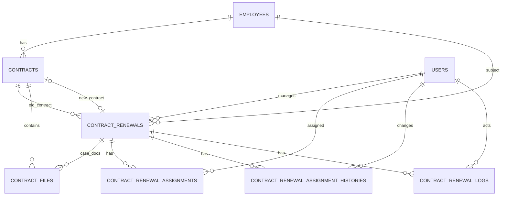

# Thiết kế DB cuối cùng - Tái ký hợp đồng (HRM)

- **Ngày chốt**: 2026-11-23
- **Nguồn nghiệp vụ**: `taiKyHopDong1.md`
- **Phạm vi**: Chỉ thiết kế DB/SQL migration chưa chạy cho chức năng tái ký hợp đồng. Không sửa code, không chạy SQL, không thay đổi DB, không xóa/sửa dữ liệu.
- **Ràng buộc giữ nguyên**: 12 bước nghiệp vụ, 6 kết quả cuối mục VIII, 13 trường hợp đặc biệt mục IV.

## 1. Quyết định đã chốt

| # | Quyết định | Chốt |
|---|---|---|
| 1 | FK bổ sung (Phase 4) | Chỉ kiểm tra và thử trên **staging** trước; **chưa bật trên production**. Bật production chỉ sau verify orphan/backfill/đánh giá rủi ro. Không bật FK `contract_files.contract_id -> contracts.id` khi chưa validate dữ liệu. |
| 2 | `uploaded_by` legacy | Giữ nguyên cột `uploaded_by`, **không backfill** khi chưa xác minh semantics (user_id hay employee_id). Dữ liệu mới ghi `uploaded_by_user_id`. |
| 3 | Collation | Dùng `utf8mb4_unicode_ci` cho bảng mới/cột mới; **không đổi collation hiện có** (`contracts=utf8mb4_bin`, `contract_files=utf8mb4_unicode_ci`). |
| 4 | File storage | Ứng dụng **không được phép xóa file** vật lý/logic row file. Cần chính sách lưu trữ và backup bảo vệ file (immutable/WORM hoặc quyền no-delete + backup/versioned object storage). DB chỉ enforce append-only; policy hạ tầng là checklist bắt buộc trước go-live. |
| 5 | `role_permissions` orphan | **Không xử lý** trong migration tái ký, không xóa/sửa dữ liệu phân quyền. Tách công việc audit riêng. |

## 2. Phạm vi bảng

- **Tái sử dụng**: `contracts`, `employees`, `users`, `roles`, `permissions`, `role_permissions`, `notifications`, `workflow_actions`.
- **Bảng mới**: `contract_renewals`, `contract_renewal_assignments`, `contract_renewal_assignment_histories`, `contract_renewal_logs`.
- **ALTER additive**: `contracts`, `contract_files`.
- **Không tạo**: `replacement_contract_id`, bảng role/permission mới, không sửa/xóa dữ liệu quyền.

## 3. ERD

## 4. Thiết kế cột cuối

### 4.1 `contracts` (ADD ONLY; không đổi cột/PK/FK/index/collation hiện có)

| Cột | Kiểu | NULL | Default | Mục đích |
|---|---|---:|---|---|
| `renewal_case_id` | BIGINT | YES | NULL | Liên kết case tái ký. |
| `previous_contract_id` | INT | YES | NULL | Chỉ HĐ mới trỏ HĐ cũ. |
| `effective_date` | DATE | YES | NULL | Ngày hiệu lực thỏa thuận. |
| `signed_at` | DATETIME | YES | NULL | Thời điểm ký hoàn tất. |
| `signed_by_company_user_id` | INT | YES | NULL | User ký phía công ty. |
| `signed_by_company_name` | VARCHAR(150) | YES | NULL | Snapshot. |
| `signed_by_employee_id` | INT | YES | NULL | Employee ký phía NLĐ. |
| `signed_by_employee_name` | VARCHAR(150) | YES | NULL | Snapshot. |
| `superseded_at` | DATETIME | YES | NULL | Thời điểm HĐ cũ bị thay thế theo căn cứ thực tế. |
| `actual_end_reason` | VARCHAR(50) | YES | NULL | Kết thúc thực tế. |
| `actual_end_at` | DATETIME | YES | NULL | Thời điểm kết thúc thực tế. |

### 4.2 `contract_files` (ADD ONLY; `contract_id` giữ INT NOT NULL)

| Cột | Kiểu | NULL | Default | Mục đích |
|---|---|---:|---|---|
| `renewal_case_id` | BIGINT | YES | NULL | Case liên quan. |
| `file_category` | VARCHAR(40) | NO | `CONTRACT_OTHER` | Phân loại nghiệp vụ. |
| `file_group_code` | VARCHAR(64) | NO | `LEGACY_DEFAULT` | Mã nhóm tài liệu; mọi phiên bản cùng nhóm dùng chung mã. |
| `version_no` | INT | NO | 1 | Phiên bản trong nhóm. |
| `is_current` | TINYINT(1) | NO | 1 | Phiên bản hiện hành của nhóm. |
| `current_flag` | TINYINT(1) | YES | generated STORED | `CASE WHEN is_current=1 THEN 1 ELSE NULL END`. |
| `replaced_file_id` | INT | YES | NULL | Self ref tới `contract_files.id`. |
| `checksum_sha256` | CHAR(64) | YES | NULL | Toàn vẹn file. |
| `uploaded_by_user_id` | INT | YES | NULL | Actor user chuẩn hóa; không thay `uploaded_by`. |
| `storage_provider` | VARCHAR(20) | NO | `LOCAL` | Nơi lưu trữ. |
| `note` | TEXT | YES | NULL | Ghi chú. |

### 4.3 `contract_renewals`

| Cột | Kiểu | NULL | Default | Mục đích |
|---|---|---:|---|---|
| `id` | BIGINT | NO | AI | PK. |
| `case_code` | VARCHAR(40) | NO | - | UK mã hồ sơ. |
| `old_contract_id` | INT | NO | - | HĐ cũ gốc. |
| `employee_id` | INT | NO | - | Nhân viên. |
| `department_id_snapshot` | INT | YES | NULL | Snapshot. |
| `manager_employee_id_snapshot` | INT | YES | NULL | Snapshot. |
| `new_contract_id` | INT | YES | NULL | HĐ mới khi đã tạo. |
| `status` | VARCHAR(40) | NO | `DETECTED` | **Chỉ tiến độ nghiệp vụ**. |
| `result_code` | VARCHAR(40) | YES | NULL | 6 kết quả cuối. |
| `current_stage` | VARCHAR(40) | NO | `STEP_1_DETECTED` | Bước/giai đoạn. |
| `assignment_status` | VARCHAR(30) | NO | `NOT_REQUIRED` | **Chỉ tình trạng người phụ trách**. |
| `current_assignee_user_id` | INT | YES | NULL | NULL khi SYSTEM/PENDING_ASSIGNMENT/NOT_REQUIRED. |
| `is_open` | TINYINT(1) | NO | 1 | 1 mở, 0 đóng. |
| `open_old_contract_id` | INT | YES | generated STORED | `old_contract_id` khi mở, NULL khi đóng. |
| các cột nghiệp vụ B1-B12/snapshot/đặc biệt | xem SQL | YES/NO | xem SQL | Đủ cho 12 bước, 6 kết quả, 13 TH đặc biệt. |
| `created_by_user_id/updated_by_user_id` | INT | YES | NULL | Audit. |
| `completed_at/created_at/updated_at` | DATETIME | NO/YES | timestamp | Audit. |

### 4.4 `contract_renewal_assignments`

Các cột chính: `id, renewal_case_id, stage_code, assignee_user_id, assignee_employee_id, assigned_by_user_id, assignment_status, is_current, current_flag(generated), assigned_at, accepted_at, due_at, completed_at, note`.

### 4.5 `contract_renewal_assignment_histories`

Các cột chính: `id, renewal_case_id, assignment_id NULL, stage_code, from_assignee_user_id, to_assignee_user_id, changed_by_user_id, change_type, reason, changed_at`.

### 4.6 `contract_renewal_logs`

Các cột chính: `id, renewal_case_id, stage_code, action_code, from_status, to_status, actor_type, actor_user_id, actor_employee_id, actor_role_id, comment, payload_before, payload_after, related_contract_id, related_file_id(INT), created_at`.

## 5. Quy tắc nghiệp vụ-kỹ thuật đã chốt

### 5.1 Tách `status` và `assignment_status`
- `contract_renewals.status`: chỉ tiến độ nghiệp vụ. Không có `PENDING_ASSIGNMENT`.
- `contract_renewals.assignment_status`: chỉ tình trạng người phụ trách. Giá trị: `NOT_REQUIRED, PENDING_ASSIGNMENT, ASSIGNED, IN_PROGRESS, COMPLETED`.
- Ví dụ: được duyệt nhưng chưa có người soạn thảo => `status=APPROVED`, `current_stage=STEP_9_ASSIGN_DRAFTER`, `assignment_status=PENDING_ASSIGNMENT`, `current_assignee_user_id=NULL`.

### 5.2 Nhiều file cùng `file_category` và version theo nhóm
- `file_group_code` định danh nhóm tài liệu logic. Cùng category có thể có nhiều nhóm.
- Unique: `(contract_id, file_group_code, version_no)` và `(contract_id, file_group_code, current_flag)`.
- Cấm ghi đè/xóa row/xóa file vật lý. Phiên bản mới: INSERT row mới + UPDATE row cũ `is_current=0`.

### 5.3 Tài liệu phát sinh trước khi có hợp đồng mới
- `contract_files.contract_id` vẫn NOT NULL, không đổi cấu trúc cũ.
- Tài liệu phát sinh trước khi có HĐ mới (hỗ trợ, biên bản, rà soát, soạn thảo giai đoạn case): lưu `contract_id = old_contract_id`, `renewal_case_id = case_id`, `file_group_code` riêng.
- Tài liệu thuộc HĐ mới sau khi tạo: `contract_id = new_contract_id`, `renewal_case_id = case_id`.
- Quy tắc kỹ thuật lưu trữ, không thêm nghiệp vụ ngoài `taiKyHopDong1.md`.

### 5.4 Chống trùng hồ sơ mở
- `is_open + open_old_contract_id GENERATED STORED + UNIQUE(open_old_contract_id)`.
- Cho phép nhiều hồ sơ đóng, chỉ 1 hồ sơ mở/old contract.

### 5.5 Phân công và PENDING_ASSIGNMENT
- 1 assignee hiện tại/`(renewal_case_id, stage_code)` bằng `current_flag` + UNIQUE.
- `PENDING_ASSIGNMENT` chỉ là trạng thái case (`assignment_status`) + history/log; không tạo assignment giả.

### 5.6 Liên kết cũ-mới
- Nguồn chính: `contract_renewals.old_contract_id/new_contract_id`.
- Phụ: `contracts.renewal_case_id`, `contracts.previous_contract_id` (chỉ HĐ mới).
- Không dùng `replacement_contract_id`. Không terminate HĐ cũ khi tạo draft; không update lương trước `effective_date`.

## 6. Nguy cơ dữ liệu hiện có và precheck

Dù `contract_files` hiện có 0 row, migration phải bảo vệ staging/DB drift:

| Nguy cơ | Ảnh hưởng | Precheck/biện pháp |
|---|---|---|
| Nhiều row hiện có cùng `contract_id` khi thêm default `file_group_code='LEGACY_DEFAULT', version_no=1` | Vi phạm `uk_cf_group_ver` | Precheck đếm `contract_id` có >1 row. Nếu có, **không chạy Phase 3 add unique** cho đến khi có kế hoạch gán `file_group_code/version_no` riêng theo nhóm tài liệu. Migration này không tự sửa dữ liệu. |
| Nhiều row hiện có cùng `contract_id` và `is_current=1` mặc định | Vi phạm `uk_cf_group_current` | Precheck đếm nhóm `(contract_id, LEGACY_DEFAULT)` có >1 row `is_current=1` hoặc tổng row >1 với default current. |
| `file_group_code` NULL/rỗng/định dạng không ổn định từ dữ liệu tương lai | Khó truy vết phiên bản | Quy ước service: `RFC_<renewal_case_id>_<category>_<ulid/uuid>` hoặc tương đương duy nhất; precheck pattern sau khi có dữ liệu. |
| `replaced_file_id` trỏ sai/chu kỳ | Mất chuỗi phiên bản | Self-FK optional chỉ sau validate; service kiểm tra cùng contract+group. |
| Chạy lại migration | Lỗi duplicate column/index/constraint hoặc drift schema | Precheck bảng/cột/index/constraint; không coi `IF NOT EXISTS` là idempotent hoàn toàn. |

## 7. An toàn cập nhật phiên bản file ở tầng service (yêu cầu thiết kế)

Mặc dù không sửa code trong lần này, triển khai service phải tuân thủ:

1. **Transaction ứng dụng**: khi tạo phiên bản mới, thực hiện trong transaction: khóa row current của nhóm (`SELECT ... FOR UPDATE` theo `contract_id,file_group_code,is_current=1`), kiểm tra `version_no` kế tiếp, INSERT file mới, UPDATE row cũ `is_current=0` (chỉ cột trạng thái/version metadata cho phép), ghi `contract_renewal_logs`.
2. **Không UPDATE nội dung file cũ**: cấm UPDATE `file_name, stored_name, file_path, file_ext, mime_type, file_size, checksum_sha256`.
3. **Không DELETE**: không DELETE row `contract_files`, không xóa file vật lý.
4. **Xử lý đồng thời**: rely vào unique `(contract_id,file_group_code,version_no)` và `(contract_id,file_group_code,current_flag)`; khi gặp duplicate key, retry có kiểm soát hoặc báo lỗi nghiệp vụ.
5. **Trước khi có HĐ mới**: dùng `contract_id=old_contract_id` + `renewal_case_id`.
6. **Quyền xóa file**: ứng dụng không có hành vi xóa; storage policy deny delete.

## 8. Rủi ro còn lại

- Semantics `uploaded_by` legacy chưa xác minh.
- `contract_files.contract_id` chưa có FK tới `contracts` ở DB hiện tại; không tự bật.
- Vòng tham chiếu `contract_renewals.new_contract_id` <-> `contracts.renewal_case_id/previous_contract_id` cần thứ tự FK/transaction service.
- Collation khác nhau giữa bảng cũ và mới có thể ảnh hưởng so sánh chuỗi ở query join đặc thù; cần test staging.
- Quy ước đặt `file_group_code` cần thống nhất trong implementation spec.
- DB sống/schema drift: luôn chạy precheck trên DB đích trước khi áp dụng.
## 9. Bổ sung sau rà soát bắt buộc trước staging

### 9.1 Precheck Phase 0.6/0.7 đã sửa
- Phase 0.6 chỉ dùng cột hiện có của `contract_files` (`contract_id`, v.v.), **không** truy vấn `is_current/file_group_code/version_no/current_flag` trước Phase 3A.
- Phase 0.7 chỉ giữ orphan check cột hiện có (`contract_files.contract_id -> contracts.id`). Orphan check cho cột mới (`replaced_file_id`, `renewal_case_id`, `uploaded_by_user_id`, `contracts.renewal_case_id/previous_contract_id/signed_by_*`, `contract_renewal_logs.related_file_id`) chuyển sang **Phase 3D** sau Phase 3C, trước Phase 4.
- Kiểm tra legacy theo hai giai đoạn: 0.6 (trước 3A, proxy bằng `rows_per_contract`) và 3B (sau 3A, kiểm tra đầy đủ bằng cột mới). Nếu có nguy cơ xung đột UNIQUE => **STOP**, không add constraint, không auto-fix data.

### 9.2 Guard ADD CONSTRAINT / rerun safety
- Phase 3C và Phase 4 tách constraint thành bước guarded: precheck `information_schema.TABLE_CONSTRAINTS` theo tên trước mỗi `ADD CONSTRAINT`; chỉ chạy khi chưa tồn tại; nếu tồn tại khác nghĩa thì STOP.
- Không dựa vào `IF NOT EXISTS` cho constraint. Nếu chạy dở, không rerun toàn file; resume theo marker phase/statement.
- `ADD CONSTRAINT` không rerun-safe mặc định trên TiDB/MySQL khi trùng tên; vì vậy phải có precheck thủ công và log RESUME.

### 9.3 Verification hành vi sau migration
- File mới: `backend/sql/20261123_contract_renewal_staging_verify.sql` (staging only).
- Bao phủ: CHECK reject invalid; generated `open_old_contract_id`; UNIQUE open case; generated `current_flag` assignment/file; UNIQUE current assignment per stage; UNIQUE file version per group; UNIQUE current file per group; same category different groups allowed; actor_type CHECK.
- Test dùng transaction/rollback, prefix `__MIGTEST__`, không chạy production, có cleanup verification.

### 9.4 Lỗ hổng còn lại (chưa phải blocker SQL migration nhưng là blocker triển khai)
- DB chưa enforce domain cho `status/assignment_status/result_code/current_stage/...` (VARCHAR tự do). Cần service validation + staging test case.
- Không có UNIQUE cho `contract_renewals.new_contract_id` / `contracts.previous_contract_id`; cần service guard.
- Vòng FK `contract_renewals <-> contracts` chỉ bật optional staging sau orphan check; cần test thứ tự transaction service.
- Code hiện tại còn terminate old contract/update salary ngay (`contracts.service.js`) — mâu thuẫn nghiệp vụ; **không sửa trong phạm vi này** nhưng là blocker trước go-live tính năng.
